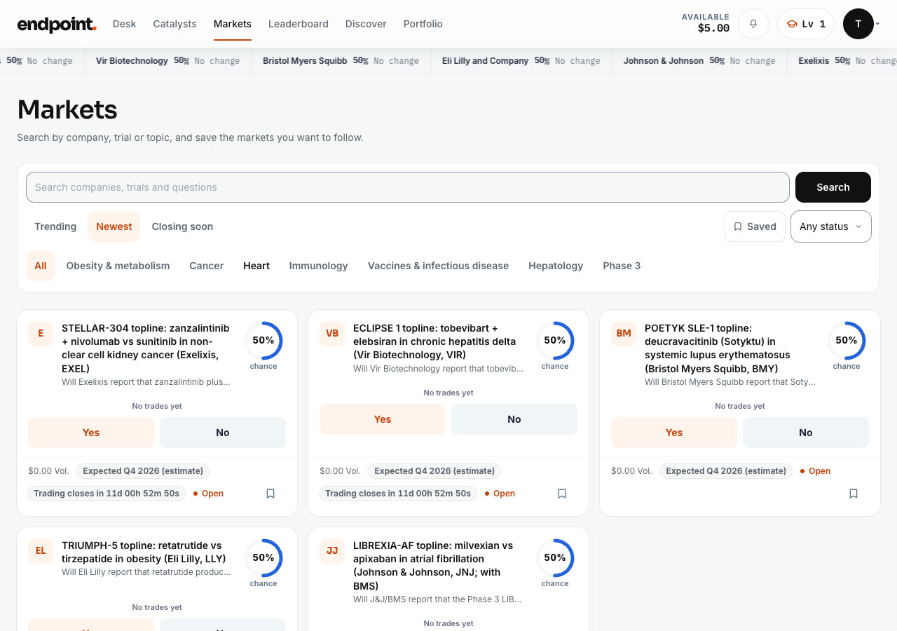
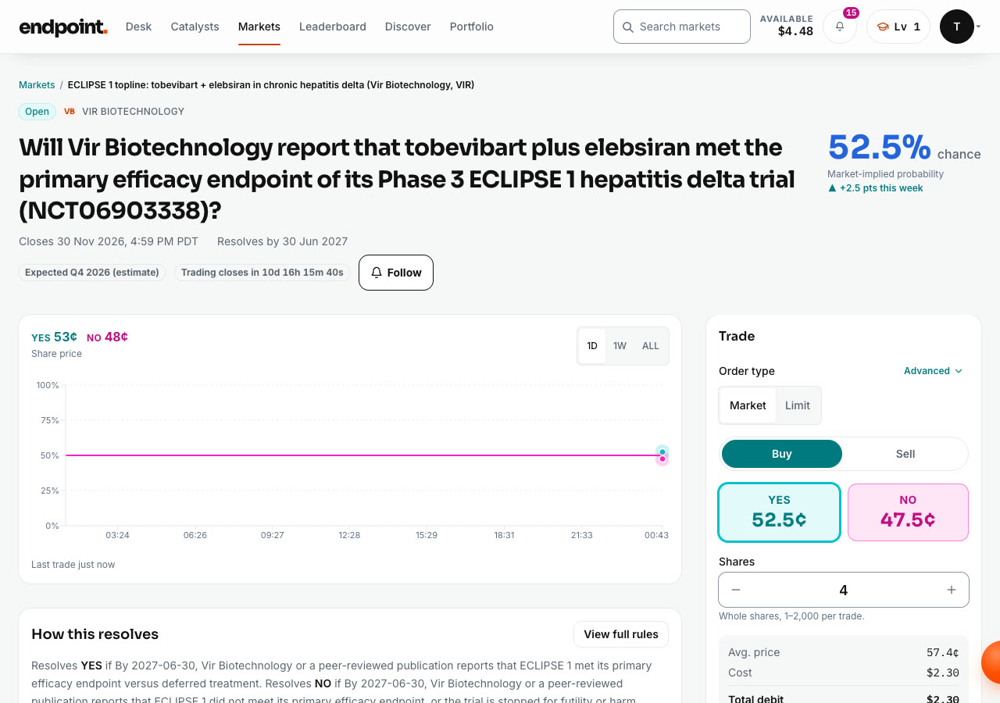
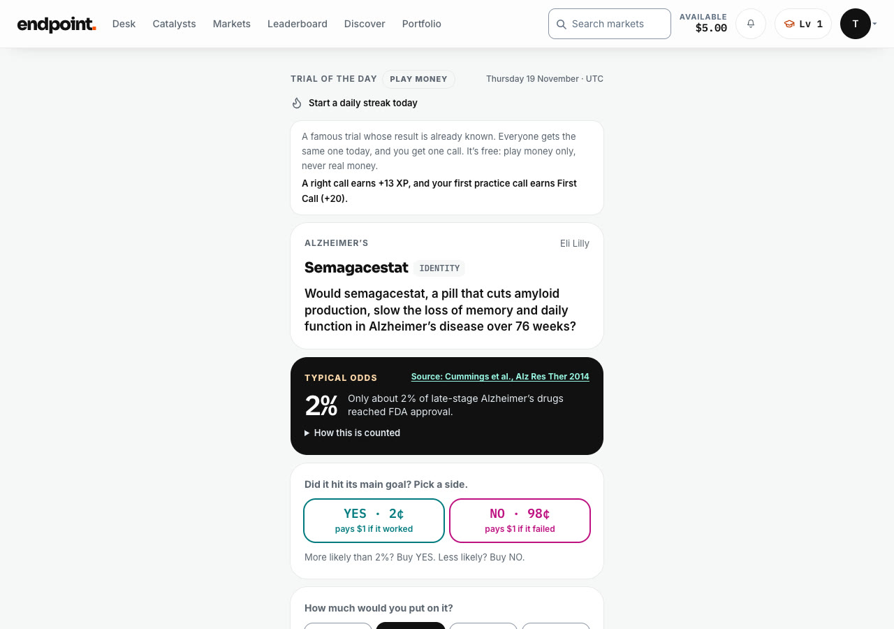
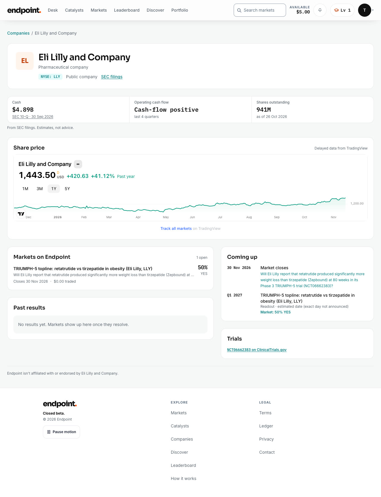

# Endpoint: a prediction market for clinical-trial results

**Predict the trial, not the stock.**

Endpoint lets people who can read a clinical trial act on what they know. Each
market asks one clear question about a real trial, for example *"Will Eli Lilly
report that retatrutide beat tirzepatide at 80 weeks in TRIUMPH-5?"*. Traders buy
YES or NO. The price is the crowd's chance. When the result is published, the
right side is paid out.

Today a biotech investor who is right about a trial can still lose money on the
stock (dilution, hype, the wider market). Endpoint prices the trial result itself.

This repository is a **showcase only**: screenshots, videos, the pitch deck and a
real test report. The application code is private.

---

## Where it stands (November 2026)

- **Live** on its own site as an invite-only closed beta, with real money:
  deposits and payouts in USDC (a US-dollar stablecoin) on the Base network,
  held in a multi-owner vault.
- Real trial markets on Eli Lilly, Vir Biotechnology, Exelixis, Johnson & Johnson,
  Bristol Myers Squibb and others, with company pages, share prices and a
  catalyst calendar.
- Not open to the public yet. Legal advice on where it can operate comes first.

## What is in this folder

| Folder | What it shows |
|---|---|
| [`video/product-demo.mp4`](video/product-demo.mp4) | 2-minute walkthrough of the product, including Pip, the AI assistant |
| [`video/pitch-video-1080p.mp4`](video/pitch-video-1080p.mp4) | 5-minute founder pitch (UBC Venture Founder application, October 2026) |
| [`video/endpoint-ad.mp4`](video/endpoint-ad.mp4) | Short ad, with music generated on a local model |
| [`deck/endpoint-pitch-deck.pdf`](deck/endpoint-pitch-deck.pdf) | The 12-slide pitch deck |
| [`screenshots/app/`](screenshots/app/) | 16 real screens from the live site |
| [`screenshots/onboarding-tour/`](screenshots/onboarding-tour/) | The guided first-visit tour, on phone and desktop |
| [`screenshots/resolution-rules/`](screenshots/resolution-rules/) | Next step for resolution: rule templates and a guided "propose the result" flow. Built and tested, **not yet released** |
| [`test-bot/`](test-bot/) | A real report from the bot swarm that trades on the live site |
| [`design-explorations/`](design-explorations/) | A visual redesign study. **Concept only, not built.** |
| [`TIMELINE.md`](TIMELINE.md) | What was built, month by month |

### Screens at a glance

| | |
|---|---|
|  |  |
| Markets: search by company, trial or disease | A market page: live chance, chart, trade ticket, resolution rules |
|  |  |
| Trial of the day: practise on a famous past trial | Company page: share price, filings, its markets |

## What the product does

- **Trading.** YES/NO and multi-outcome markets priced by an automated market
  maker (LMSR, a standard formula that always quotes a price). Market and limit
  orders. A price guard refuses a trade if the price moved before it filled.
- **Real money.** Deposits proven to belong to the user, withdrawals with
  two-factor approval, a balanced double-entry ledger in whole thousandths of a
  dollar, and a vault that needs several owners to move funds.
- **Resolution.** Every market names its sources up front. An admin proposes the
  result, there is a 48-hour challenge window, then automatic payout.
- **Research pipeline.** Pulls trials from ClinicalTrials.gov and filings from
  the SEC, drafts market questions, and has an AI check each draft. A person
  approves every market.
- **Pip, the AI assistant.** Built on the Claude API. Answers questions about
  markets, trials and companies from live data, links its sources, and can
  prepare a trade for the user to confirm. It never trades on its own.
- **Faster markets.** Daily closing-price markets and earnings markets, with
  report dates read from SEC filings. Both are built; they open once the
  operator account is funded.
- **Learning and engagement.** A practice mode on famous past trials, a daily
  trial, estimates scored for accuracy, a career ladder (Undergrad to Lab Tech
  to Med School), badges, leaderboards and a swipe discovery feed.
- **Gifts.** Users can send cash to each other (share gifts are built but
  switched off).
- **Admin.** A web console and a native Android app for approvals, alerts and
  market operations.
- **Public API.** A read-only developer API with keys and rate limits.

## How it was built

I built the software myself, but not by typing the code. I directed AI coding
agents, mainly **Claude Code**, and kept them to a written specification. For
about two weeks in September the work ran on OpenAI's Codex instead.

The way of working, which grew over five months:

- **One written specification is the source of truth.** Every feature starts as
  a change to the spec, which I approve before code is written.
- **Decisions are recorded.** 160 short decision records explain why each
  choice was made, so later sessions do not undo earlier ones.
- **Planner and builders.** One model plans, reviews and releases. Builder
  agents write the code in parallel, each on its own branch.
- **Tests before every next stage**, then a check on the real site before I
  hear "it's done".
- **Hard safety fences** for real money: money stored as whole numbers, every
  ledger write balanced, records never edited after the fact, and merges and
  production changes approved by me.
- **A bot swarm tests the live site.** Eight test accounts trade against each
  other with real money (one share per trade) and report anything that breaks.
  See [`test-bot/`](test-bot/).

### By the numbers (main branch, 20 November 2026)

| | |
|---|---|
| Started | 9 June 2026 |
| Commits | 867 |
| Pull requests | about 165 |
| Decision records | 160 |
| Database migrations | 87 |
| Test files | 774 |
| Biggest live bot run | 266 real-money trades in 10 minutes, every balance exact |

Stack: Next.js 15 and React 19, Postgres (Neon) with Drizzle, Auth.js, Vercel,
viem and Safe for on-chain custody on Base, the Anthropic SDK for Pip, and a
Kotlin Android app.

---

Built by Adrian Tabari, co-founder of Endpoint with Farshad Felfelian.
